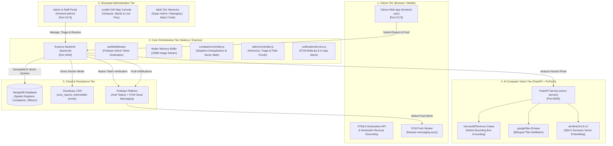

# 🏛️ Civic Issue Reporting & Municipal Management Platform
### Multimodal AI Vision, Leaflet GIS Hotspots, Cloudinary CDN, FCM Push Notifications & Spatial Deduplication

[](https://nodejs.org/)
[](https://fastapi.tiangolo.com/)
[](https://react.dev/)
[](https://www.mongodb.com/)
[](https://cloudinary.com/)
[](https://firebase.google.com/)
[](https://leafletjs.com/)
[](https://pytorch.org/)

---

## 📖 Executive Overview

The **Civic Issue Reporting & Municipal Management Platform** is a full-stack, enterprise-grade urban grievance management and GIS dispatch system. It bridges citizens and city municipal administrations through automated **Vision-Language AI**, geospatial deduplication, real-time ticket progression, and multi-tier role-based field dispatching.

### Key Capabilities:
1. **AI Multimodal Hazard Inspection:** Instantly detects urban defects (potholes, garbage piles, broken streetlights, waterlogging, open manholes) using **Microsoft Florence-2-base**, draws defect bounding boxes, and generates dual English/Hindi formal municipal titles via **Google FLAN-T5**.
2. **Spatial Deduplication & Semantic Clustering:** Automatically identifies duplicate reports within a **200-meter geographic radius** via MongoDB `2dsphere` queries combined with **384-dimensional dense semantic vectors** from `all-MiniLM-L6-v2`.
3. **Interactive GIS Municipal Map Console:** Provides citywide spatial visualization with severity-coded teardrop pins (`🔴 Critical`, `🟠 High`, `🟡 Medium`, `🔵 Low`, `🟢 Resolved`), dynamic high-density hotspot circles, and one-click ticket inspection.
4. **4-Tier Municipal Role-Based Access Control (RBAC):** Strict operational segregation for **Super Admin** (City Head), **Managing Officer** (Citywide Triage), **Ward Officer** (Ward Supervision), and **Field Officer** (On-site repair & proof upload).
5. **Real-time Push & In-App Notifications:** Sends native **Firebase Cloud Messaging (FCM)** push notifications and in-app alerts on every ticket transition (`Submitted` ➔ `Assigned` ➔ `In Progress` ➔ `Resolved` ➔ `Closed`).

---

## 🏗️ 4-Tier System Architecture



---

## 📁 Repository Directory Structure

```
Final Year Project/
├── CIVIC_PROJECT_ENV_AND_SETUP_GUIDE.pdf # Unified team environment & setup guide
├── generate_guide_pdf.py                # Python script to regenerate master PDF
├── .gitignore                           # Repository root Git protection rules
│
├── backend/                             # Core Express API Orchestrator (Port 5000)
│   ├── config/                          # MongoDB & Firebase Admin configuration
│   ├── controllers/                     # Complaint, Admin RBAC & Notification controllers
│   ├── middleware/                      # Firebase Bearer Auth, Multer memory storage
│   ├── models/                          # Complaint, Officer, and Notification schemas
│   ├── routes/                          # Express REST endpoints (/api/complaints, /api/admin)
│   ├── utils/                           # Cloudinary streaming, FCM multicast, Vector math
│   ├── tests/                           # Unit and integration test suites
│   ├── .env.example                     # Backend environment configuration template
│   └── server.js                        # HTTP entrypoint & CORS orchestrator
│
├── frontend-user/                       # Citizen Web Application (Port 5173)
│   ├── public/                          # Service workers (firebase-messaging-sw.js)
│   ├── src/
│   │   ├── components/                  # Navbar, NotificationDrawer, ComplaintCard
│   │   ├── context/                     # AuthContext, NotificationContext
│   │   ├── pages/                       # Home, SubmitComplaint, MyComplaints, Details
│   │   └── services/                    # Axios API client & Firebase Web SDK config
│   ├── .env.example                     # Citizen portal environment template
│   └── package.json
│
├── frontend-admin/                      # Municipal Admin & Staff Portal (Port 5174)
│   ├── src/
│   │   ├── components/admin/            # AdminHeader, InspectorModal, OfficerForms
│   │   ├── context/                     # AuthContext with multi-tier RBAC switcher
│   │   ├── pages/admin/                 # Dashboard, MapConsole, ComplaintsTable, ManageOfficers
│   │   └── services/                    # Municipal API endpoints
│   ├── .env.example                     # Admin portal environment template
│   └── package.json
│
└── micro-service/                       # Standalone AI Vision & NLP Microservice (Port 8000)
    ├── venv/                            # Isolated Python environment with CUDA PyTorch
    ├── main.py                          # FastAPI application, Florence-2 & FLAN-T5 pipelines
    ├── patch_florence.py                # Transformers compatibility patches
    ├── requirements.txt                 # Python dependencies
    ├── run.bat                          # Pre-launch Windows App Control unblock & Uvicorn runner
    └── .env.example                     # AI microservice environment template
```

---

## 🏛️ Municipal Role-Based Access Control (RBAC)

The administrative portal (`frontend-admin`) implements a 4-tier operational hierarchy:

| Role | Title | Operational Scope | Permitted Actions |
| :--- | :--- | :--- | :--- |
| `super_admin` | **City Head / IT Admin** | Full Citywide Access | System-wide visibility, create/manage municipal officers across all wards, delete or override records, full GIS access. |
| `managing_officer` | **Managing Officer** | Citywide Strategic Triage | Monitor tickets across all wards, reassign complaints across wards, escalate upward, modify ticket severity, post official supervisory notes. |
| `ward_officer` | **Ward Officer** | Ward-Level Supervision | Full oversight of assigned ward issues, triage severity (`CRITICAL`, `HIGH`, `MEDIUM`, `LOW`), add municipal comments, dispatch tasks to field crews. |
| `field_officer` | **Field Crew / Worker** | On-Site Execution | Update ticket status to `In Progress`, upload on-site work photos, upload resolution proof photos, mark complaints as `Resolved`. |

---

## 🔐 Super Admin & Officer Account Management

The platform provides CLI automation tools and Web UI interfaces for initializing, managing, and resetting administrator and officer credentials:

### 1. Bootstrapping the Super Admin Account (CLI)
Before signing into the Admin Portal for the first time, initialize the Super Admin account via the backend CLI helper:
```bash
cd backend
node scripts/initSuperAdmin.js <email> [optional_password]
```
- **Example:**
  ```bash
  node scripts/initSuperAdmin.js admin@municipal.gov.in CivicAdmin@2026
  ```
- *Default Password (if omitted):* `CivicAdmin@2026`
- *Automatic Sync:* Creates the account in Firebase Auth with `{ role: 'super_admin' }` custom claims and provisions the user record in MongoDB.

### 2. Signing In to the Municipal Portal
- **Login URL:** `http://localhost:5174/admin/login`
- **Default Super Admin Credentials:**
  - **Email:** `admin@municipal.gov.in`
  - **Password:** `CivicAdmin@2026`

### 3. Creating & Managing Officers via Web Portal (`/admin/officers`)
Logged-in Super Admins can manage all municipal staff directly from the Web UI:
- **Add Officer:** Navigate to **Manage Officers** (`/admin/officers`) and configure:
  - Full Name, Official Email, Initial Password (minimum 6 characters)
  - Operational Role (`Managing Officer`, `Ward Officer`, or `Field Officer`)
  - Assigned Ward (select assigned ward or "All Wards" for Managing Officer)
  - Department (Roads, Sanitation, Water Supply, Electricity, etc.)
- **Deactivate / Delete:** Instantly toggle officer leave status or revoke credentials.

### 4. Password Reset & Email Update CLI Helpers
- **Reset Any User or Officer Password:**
  ```bash
  cd backend
  node scripts/resetPassword.js <email> <new_password>
  ```
- **Change Super Admin Email:**
  ```bash
  cd backend
  node scripts/changeSuperAdminEmail.js <old_email> <new_email>
  ```
- **Wipe Test Complaints (Fresh Demo Database):**
  ```bash
  cd backend
  node scripts/clearAllData.js
  ```


---

## 🗺️ Leaflet GIS Map Console & Hotspots

The Municipal Map Console (`/admin/map`) provides GIS intelligence:
- **Severity Teardrop Markers:**
  - 🔴 **Red:** `CRITICAL` severity hazards (pulsing beacon animation).
  - 🟠 **Orange:** `HIGH` severity issues.
  - 🟡 **Yellow:** `MEDIUM` severity issues.
  - 🔵 **Blue:** `LOW` severity / newly submitted issues.
  - 🟢 **Green:** `Resolved` archive tickets.
- **Dynamic Hotspot Circles:** Automatic red semi-transparent circular overlays highlight dense clusters with high ticket volume, guiding emergency municipal resource allocation.
- **Single-Click Inspection:** Clicking any pin or using `?locate=ID` opens the comprehensive complaint inspection drawer with before/after photos and dispatch controls.

---

## 🚀 Quick Start & Installation

### Prerequisites:
- **Node.js:** v18.0.0 or higher
- **Python:** v3.10+ (with NVIDIA CUDA support if using GPU)
- **MongoDB:** Local Community Server running at `mongodb://127.0.0.1:27017` or MongoDB Atlas URI
- **Cloud Accounts:** Cloudinary (free tier) and Firebase Project (Web App + Service Account JSON)

### Step 1: Clone Repository & Setup Environment Files
```bash
git clone <YOUR_REPO_URL>
cd "Final Year Project"
```

Configure the `.env` file in each of the 4 subdirectories using the templates in [CIVIC_PROJECT_ENV_AND_SETUP_GUIDE.pdf](CIVIC_PROJECT_ENV_AND_SETUP_GUIDE.pdf) or the respective `.env.example` files:
1. `backend/.env`
2. `frontend-user/.env`
3. `frontend-admin/.env`
4. `micro-service/.env`

*(Place your Firebase `serviceAccountKey.json` inside the `backend/` folder).*

### Step 2: Install Dependencies
```bash
# Backend dependencies
cd backend && npm install && cd ..

# Citizen Portal dependencies
cd frontend-user && npm install && cd ..

# Admin Portal dependencies
cd frontend-admin && npm install && cd ..

# AI Microservice dependencies
cd micro-service
python -m venv venv
venv\Scripts\activate
pip install -r requirements.txt
cd ..
```

---

## ⚡ Running the Platform (4 Terminals)

Open 4 separate terminal windows:

### Terminal 1: AI Vision Microservice (Port 8000)
```powershell
cd "Final Year Project\micro-service"
.\run.bat
```
*(Runs on `http://127.0.0.1:8000` with Swagger docs at `http://127.0.0.1:8000/docs`)*

### Terminal 2: Backend Orchestrator (Port 5000)
```powershell
cd "Final Year Project\backend"
npm run dev
```
*(Runs on `http://localhost:5000` with health check at `http://localhost:5000/health`)*

### Terminal 3: Citizen Web Portal (Port 5173)
```powershell
cd "Final Year Project\frontend-user"
npm run dev
```
*(Available in browser at `http://localhost:5173`)*

### Terminal 4: Municipal Admin Portal (Port 5174)
```powershell
cd "Final Year Project\frontend-admin"
npm run dev
```
*(Available in browser at `http://localhost:5174/admin`)*

---

## 🛡️ Git Security Protocol

This repository is protected by comprehensive `.gitignore` rules at both the root and subdirectory levels:
- Real `.env` files and `serviceAccountKey.json` are **NEVER** committed to Git.
- Machine learning model weights (`*.pt`, `*.pth`, `*.safetensors`) and virtual environments (`venv/`, `node_modules/`) are strictly ignored.
- Only `.env.example` templates and source code are tracked in the version control history.

---

## 📄 Documentation & Team References
- **Master Setup Guide:** [CIVIC_PROJECT_ENV_AND_SETUP_GUIDE.pdf](CIVIC_PROJECT_ENV_AND_SETUP_GUIDE.pdf)
- **Backend Architecture:** [backend/README.md](backend/README.md)
- **Citizen Portal Guide:** [frontend-user/README.md](frontend-user/README.md)
- **Admin Portal Guide:** [frontend-admin/README.md](frontend-admin/README.md)
- **AI Microservice Guide:** [micro-service/README.md](micro-service/README.md)
